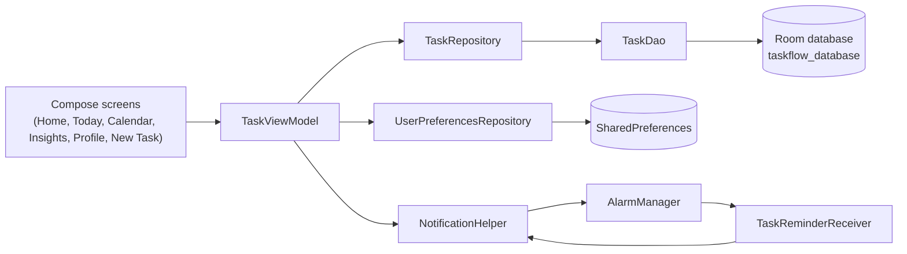

<a id="readme-top"></a>

<div align="center">


# TaskFlow

**Plan. Prioritize. Perform.**

A calm, offline-first task manager for Android with flexible scheduling, a built-in focus timer, and productivity insights, all stored privately on your device.


[Features](#features) · [Getting Started](#getting-started) · [Architecture](#architecture) · [Roadmap](#roadmap) · [Contributing](#contributing)

</div>

---

## About

TaskFlow helps you decide what to do, when to do it, and how well you are keeping up. Tasks live in a local Room database, reminders are delivered through the system alarm service, and every insight on screen is computed on-device. There is no account, no sign-in, and no server.

<!--
Screenshots: add images to docs/screenshots/ and uncomment this block.

<div align="center">
  
  
  
  
</div>
-->

## Features

### Planning
- **Flexible scheduling**: one day, 2 to 5 days, multiple days (weekday and weekend presets, or every day of the year), or forever.
- **Rich tasks**: title (up to 100 characters), description (up to 1,000), priority (Low, Medium, High), project, time of day, scheduled time, and an optional attachment.
- **Projects**: Core Work, Marketing, Personal, Study, Health & Wellness, or your own.
- **Smart validation**: rejects empty titles, control characters, and duplicate task names.
- **Automatic daily reset**: recurring tasks return to pending at the start of each new day.

### Views
- **Home**: daily performance summary, search, quick filters (All, Starred, High Priority, Core Work, Completed), and time-window filtering.
- **Today**: tasks grouped into Morning Focus, Afternoon Flow, and Evening Wind-Down, with a daily progress bar.
- **Calendar**: month view with a per-day agenda and quick add.
- **Insights**: completion accuracy, weekly velocity, focus trend, project distribution, and time-of-day energy charts, all drawn with Compose Canvas.

### Focus and motivation
- **Focus mode**: a full-screen timer (5 to 120 minutes, 25 by default) tied to a task. Completed sessions are logged.
- **Streaks**: calculated from the days on which you complete tasks.
- **Achievements**: 12 badges such as Task Master, Streak Warrior, Focus Ninja, Early Bird, and Night Owl.
- **Daily thought**: a quote for every day of the year, including leap day.

### Reminders and personalization
- **Per-task reminders** with a configurable default (5 minutes to 1 day before), plus in-app notification banners.
- **Light, Dark, or System** theme, a custom display name, and a profile photo from built-in presets or your gallery.
- **Full data reset** from the profile screen.

<p align="right">(<a href="#readme-top">back to top</a>)</p>

## Tech Stack

| Area | Technology |
| --- | --- |
| Language | Kotlin 2.2.10 (JVM target 17) |
| UI | Jetpack Compose (BOM 2024.09.00), Material 3, Material Icons Extended |
| Navigation | Navigation Compose 2.8.9 |
| State | `ViewModel`, Kotlin Coroutines and `StateFlow` |
| Persistence | Room 2.7.0 (via KSP), `SharedPreferences` for settings |
| Images | Coil 2.7.0 |
| Background work | `AlarmManager`, `BroadcastReceiver`, `NotificationCompat` |
| Build | Android Gradle Plugin 8.11.1, Gradle version catalog, KSP |
| Testing | JUnit 4, Robolectric, Roborazzi, Compose UI Test, Espresso |

## Architecture

TaskFlow follows a single-activity, unidirectional data flow design: Composable screens observe `StateFlow`s exposed by one shared `TaskViewModel` and send user actions back to it.



### Project structure

```text
app/src/main/java/com/example/
├── MainActivity.kt                 # Entry point, theme and notification permission
├── data/
│   ├── dao/TaskDao.kt              # Room queries (tasks, focus sessions)
│   ├── database/TaskFlowDatabase.kt
│   ├── model/                      # TaskEntity, FocusSessionEntity, ScheduleType
│   └── repository/                 # TaskRepository, UserPreferencesRepository
├── ui/
│   ├── components/                 # TaskCard, FocusTaskCard, BottomNavigationBar, ...
│   ├── navigation/NavGraph.kt      # Routes and bottom bar
│   ├── screens/                    # Home, Today, Calendar, Insights, Profile, NewTask, ...
│   ├── theme/                      # Color, Type, Theme (light, dark, system)
│   └── viewmodel/TaskViewModel.kt  # App state, validation, focus timer, streaks
└── util/
    ├── DailyThoughtProvider.kt     # 366 daily quotes
    ├── NotificationHelper.kt       # Channel, alarms, notifications
    └── TaskReminderReceiver.kt
```

### Data model

| Table | Key fields |
| --- | --- |
| `tasks` | `title`, `description`, `date`, `scheduleType`, `selectedDates`, `timeOfDay`, `scheduledTime`, `priority`, `project`, `isCompleted`, `isStarred`, `isFocusTask`, `estimatedDurationMinutes`, `notificationEnabled`, `notificationTime`, `attachmentUri` |
| `focus_sessions` | `taskId`, `taskTitle`, `durationMinutes`, `timestamp` |

Indexes exist on `title`, `project`, `date`, `isCompleted`, and `priority`. Dates are stored as `yyyy-MM-dd` strings.

## Getting Started

### Prerequisites

- [Android Studio](https://developer.android.com/studio), a recent stable release that supports Android Gradle Plugin 8.11.1
- JDK 17 (bundled with Android Studio)
- Android SDK Platform 36
- An emulator or physical device running Android 7.0 (API 24) or higher

### Run locally

1. **Clone** the repository.
   ```bash
   git clone https://github.com/<your-username>/taskflow.git
   cd taskflow
   ```
2. **Open** the project folder in Android Studio and let Gradle sync finish.
3. **Fix debug signing.** The `debug` build type points at `debug.keystore` in the project root, which is git-ignored. Either delete this line from `app/build.gradle.kts`, so Android Studio uses its default debug key:
   ```kotlin
   debug { signingConfig = signingConfigs.getByName("debugConfig") }
   ```
   or generate the keystore:
   ```bash
   keytool -genkey -v -keystore debug.keystore -storepass android \
     -alias androiddebugkey -keypass android -keyalg RSA -keysize 2048 \
     -validity 10000 -dname "CN=Android Debug,O=Android,C=US"
   ```
4. **Run** the `app` configuration on your device or emulator. On Android 13 and above, allow the notification permission when prompted so reminders can appear.

### Command line

The repository does not include the Gradle wrapper. Generate it once with a local Gradle installation, then build as usual:

```bash
gradle wrapper
./gradlew assembleDebug
./gradlew installDebug
```

### Configuration

| Item | Purpose |
| --- | --- |
| `.env` | Optional. Copy `.env.example` to `.env` to supply `GEMINI_API_KEY`. The current code does not call any Gemini API, so the app runs without it. |
| `google-services.json` | Not required. The build is configured to continue without it. |

### Release builds

Release signing reads its credentials from the environment. The key alias must be `upload`.

```bash
export KEYSTORE_PATH=/path/to/my-upload-key.jks   # defaults to ./my-upload-key.jks
export STORE_PASSWORD=...
export KEY_PASSWORD=...
./gradlew assembleRelease
```

Never commit keystores or passwords.

## Privacy

All tasks, focus sessions, and preferences are stored locally in a Room database and `SharedPreferences`. TaskFlow does not require an account and does not send your data to any server.

## Testing

JUnit, Robolectric, Roborazzi, and Compose UI test dependencies are configured. The test sources are still the project template and need updating to match the app (see [Roadmap](#roadmap)). Once they do:

```bash
./gradlew test                     # local unit tests
./gradlew connectedAndroidTest     # instrumented tests (device required)
```

## Roadmap

Known gaps and planned improvements:

- [ ] Update the template tests (`Greeting`, `MyApplicationTheme`, and the app-name assertion) and add coverage for scheduling logic, validation, and streak calculation
- [ ] Re-arm reminders after a device reboot and for each occurrence of recurring tasks (alarms are currently set once, for the task's start date)
- [ ] Replace destructive Room migrations (`fallbackToDestructiveMigration`) with real migrations before the first public release
- [ ] Optional cloud sync (the Firebase dependencies and `syncedWithCloud` field are scaffolding and are not wired up yet)
- [ ] Replace the placeholder `com.example` namespace and align branding and version strings across the app
- [ ] Export and import of tasks
- [ ] Home-screen widgets

## Contributing

Contributions are welcome.

1. Fork the repository and create a branch: `git checkout -b feature/your-feature`
2. Make your changes, following the official Kotlin code style (`kotlin.code.style=official`)
3. Commit with a clear message and push the branch
4. Open a pull request describing what changed and why

Please open an issue first for larger changes so the approach can be discussed.

## License

No license has been selected yet, so all rights are reserved by default. Add a `LICENSE` file (for example MIT or Apache-2.0) and update this section before accepting outside contributions.

## Acknowledgments

- [Jetpack Compose](https://developer.android.com/jetpack/compose) and [Material 3](https://m3.material.io/)
- [Room](https://developer.android.com/training/data-storage/room)
- [Coil](https://coil-kt.github.io/coil/)
- [Roborazzi](https://github.com/takahirom/roborazzi) and [Robolectric](https://robolectric.org/)
- [Shields.io](https://shields.io/) for badges

<p align="right">(<a href="#readme-top">back to top</a>)</p>